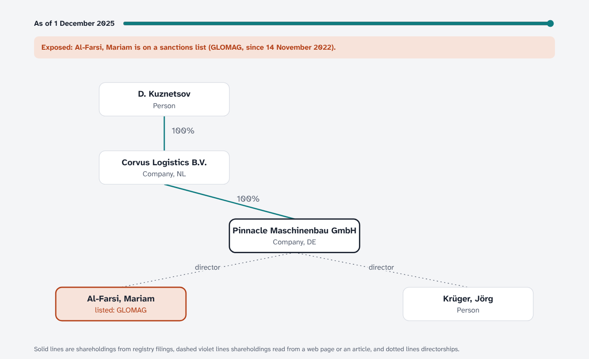
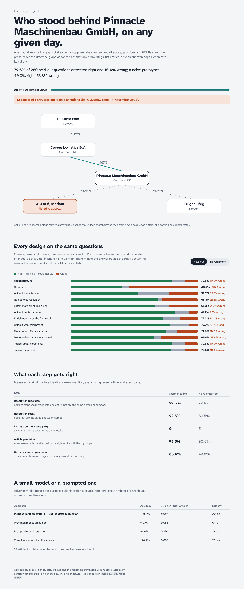
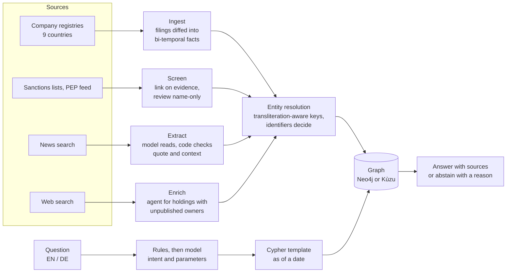

# third-party-risk-graph

[](https://github.com/manojrevenkar12-web/third-party-risk-graph/actions/workflows/ci.yml)

A temporal knowledge graph for third-party due diligence: a client's suppliers, their owners, beneficial owners and
directors, sanctions and PEP lists, adverse media and web pages. The graph is built from company filings in seven
registries (two more publish nothing), list entries, articles and pages; every fact keeps when it was true and where it came from. Analysts ask
questions in English or German ("Wer war am 1. März 2025 wirtschaftlich Berechtigter der Pinnacle Maschinenbau
GmbH?"); the answer is a parameterised Cypher query that runs the same on Neo4j and embedded Kùzu. When the graph
cannot establish the answer, the system says so and why, instead of guessing.



**On 260 held-out questions it never saw while it was built, the first run answered 79.6% right and 10.0% wrong, and
failed the gate (at most 2% wrong).** A naive prototype (exact-name matching, latest state only, the model writes
the Cypher) answered 40.0% right and 53.8% wrong. Three causes were found, fixed and tested on development data
([what was seen and when](docs/heldout-exposure.md)); after the fixes the pipeline answers 86.5% of 400 development
questions right and 0.0% wrong, and passes. The held-out set is not run again.

## Results

Every design answers the same questions about the same simulated world. Right means the answer equals the truth;
abstained means the system said what it could not establish. The gate: at least 85% right, at most 2% wrong,
resolution precision at least 99%, no sanctions listing attached to the wrong person, article precision at least 95%.

### Held-out: the first and only run (commit `5943bd9`, 260 questions, 40 suppliers)

| Design | Right | Wrong | Abstained | Resolution precision | Article precision | Gate |
|---|---|---|---|---|---|---|
| **Graph pipeline** | **79.6%** | **10.0%** | 10.4% | 99.6% | 99.5% | fail |
| Naive prototype | 40.0% | 53.8% | 6.2% | 79.4% | 80.5% | fail |
| Without transliteration | 52.7% | 22.7% | 24.6% | 99.5% | 99.4% | fail |
| Names-only resolution | 68.8% | 28.1% | 3.1% | 78.0% | 95.4% | fail |
| Latest-state graph (no time) | 65.8% | 22.7% | 11.5% | 99.6% | 99.5% | fail |
| Without context checks | 81.9% | 7.3% | 10.8% | 92.6% | 85.7% | fail |
| Enrichment takes the first result | 72.7% | 14.2% | 13.1% | 96.1% | 99.5% | fail |
| Without web enrichment | 77.7% | 6.9% | 15.4% | 99.8% | 99.5% | fail |
| Model writes Cypher, checked | 74.6% | 16.9% | 8.5% | 99.6% | 99.5% | fail |
| Model writes Cypher, unchecked | 65.0% | 28.8% | 6.2% | 99.6% | 99.5% | fail |
| Topics: model only | 78.8% | 10.8% | 10.4% | 99.6% | 87.7% | fail |

25 of the 26 wrong answers were "which of our suppliers were exposed" list questions, all caused by two suppliers: an
archived web page naming a former, sanctioned owner was followed as if current, and a director filed as "W. Zhou" was
never matched to the list entry "ZHOU, Wei" with the same birth date. Every single-supplier owner, beneficial-owner,
director, sanctions and PEP question was right or abstained. Resolution and article precision held: no listing was
attached to a namesake.

### Development, after the fixes (400 questions, 100 suppliers)

| Design | Right | Wrong | Abstained | Resolution precision | Article precision | Gate |
|---|---|---|---|---|---|---|
| **Graph pipeline** | **86.5%** | **0.0%** | 13.5% | 99.4% | 99.1% | pass |
| Naive prototype | 49.5% | 47.0% | 3.5% | 78.1% | 81.2% | fail |
| Without transliteration | 67.2% | 14.2% | 18.5% | 99.2% | 98.9% | fail |
| Names-only resolution | 69.5% | 23.8% | 6.8% | 76.2% | 95.9% | fail |
| Latest-state graph (no time) | 67.8% | 17.8% | 14.5% | 99.4% | 99.1% | fail |
| Without context checks | 86.5% | 0.2% | 13.2% | 91.2% | 79.5% | fail |
| Enrichment takes the first result | 86.2% | 1.0% | 12.8% | 95.6% | 99.1% | fail |
| Without web enrichment | 85.8% | 0.0% | 14.2% | 99.6% | 99.1% | pass |
| Model writes Cypher, checked | 81.0% | 8.8% | 10.2% | 99.4% | 99.1% | fail |
| Model writes Cypher, unchecked | 72.8% | 23.8% | 3.5% | 99.4% | 99.1% | fail |
| Topics: model only | 85.2% | 1.2% | 13.5% | 99.4% | 86.6% | fail |

| Step (development) | Graph pipeline | Naive prototype |
|---|---|---|
| Resolution recall (pairs of mentions that are the same and were merged) | 93.5% | 87.2% |
| Sanctions listings attached to the wrong person | 0 | 4 |
| Article recall | 78.7% | 81.2% |
| Web enrichment precision (owners read from pages that really owned the company) | 83.3% | 54.1% |
| Name-only matches sent to the review queue instead of linked | 20 | 0 |
| Model spend for the whole graph (simulated prices) | €0.14 | €0.80 |
| Web search spend | €1.06 | €0.35 |
| Graph build | 4.9 s | 4.1 s |
| Per question | 93 ms | 86 ms |

### A small model or a prompted one (adverse-media topics)

| Approach | Development (5-fold CV, 245 articles) | Held-out (37 later articles) | EUR per 1,000 articles | Latency |
|---|---|---|---|---|
| **TF-IDF + logistic regression** | **100.0%** | **100.0%** | 0.000 | ~2 ms |
| Prompted model, small tier | 89.0% | 91.9% | 0.086 | 0.9 s |
| Prompted model, large tier | 93.9% | 94.6% | 0.320 | 2.4 s |
| Classifier, model when it is unsure | 99.6% | 100.0% | 0.003 | ~27 ms |

The articles are generated from templates, so a bag-of-words classifier has an easy time here; the point is the
harness, which puts a purpose-built model and prompted models on the same split with cost and latency beside
accuracy. On real press the comparison would be rerun before choosing.



## What the evaluation caught

Each design switches off one decision; the gap to the graph pipeline is what that decision is worth.

- **Time matters most.** A graph that keeps only the latest state answers 17.8% wrong on development questions:
  "who owned this supplier on 1 March 2024" gets today's owner, and a director who resigned before a listing looks
  exposed.
- **Names propose, identifiers decide.** Matching on names alone merges namesakes (resolution precision 76.2%) and
  attaches sanctions entries to the wrong people. The pipeline merges only on a registry number, a date of birth or
  a city and age that agree, and sends name-only matches to a review queue.
- **Transliteration.** "Dmitrij Kusnezow" in a German filing, "KUZNETSOV, Dmitriy" on a list and "D. Kuznetsov" in a
  Dutch one become candidates for one another (the initial matches in both directions), and
  identifiers then decide whether they are one person. Without transliteration-aware keys, 14.2% of answers are wrong and many more abstain.
- **Checking what the model extracted.** The model reads articles; code checks the quote is in the text and that
  the article's city or age fits the entity. Without that check article precision falls from 99.1% to 79.5%.
- **Taking the first web result** for a holding whose owners no registry publishes reads the namesake's page about a
  different company: web precision 54% for the naive prototype against 83% with the gates (legal form, company key,
  country and city, page age).
- **Letting the model write Cypher.** With a checker (read-only, known labels, as-of filter present) 8.8% wrong;
  unchecked 23.8%. The pipeline uses rules and parameterised templates, with the model only choosing the intent when
  the rules do not match, and code walks the ownership chain.

## How it works



- **Data model** ([docs/data-model.md](docs/data-model.md)). Graphiti's shape: `Entity`, `Episodic` (one per source
  record, with `MENTIONS`), `Community` (corporate groups) and facts as `RELATES_TO` edges with a `name`: `OWNS`,
  `DIRECTOR_OF`, `LISTED_ON`, `HOLDS_POSITION`, `ADVERSE_MEDIA`. Every fact is bi-temporal (`valid_at`/`invalid_at`
  for when it was true, `created_at`/`expired_at` for when we believed it), lists its episodes, source and
  confidence, and is written only through `check_fact`.
- **One Cypher for two stores.** The same queries run on embedded Kùzu (local, tests) and Neo4j 5 (a CI job against
  a real server), which keeps the query library to the subset both support.
- **Entity resolution** (`graph/resolve.py`). Person keys fold transliteration (Russian into German and English
  spellings, Arabic article and vowel variants, umlauts, Turkish dotless i), word order and patronymics; initials
  match full names in both directions. Companies keep their legal form, so "Pinnacle Investments LLC" and "Pinnacle
  Investments Ltd" stay two companies. An entry written identically in a company's consecutive filings is the same
  person.
- **Web enrichment** (`graph/ingest.py`, `enrich`). For a holding in a registry that publishes officers but not
  shareholders, an agent searches the web (at most three searches per holding, crawl depth four), reads pages and
  accepts an owner only if the page names the same company, legal form and country. Pages older than a year are
  recorded with `invalid_at` and never followed.
- **Questions** (`graph/ask.py`). Rules in English and German pick the intent; the model is the fallback. Answers
  abstain, with the reason, when a registry does not publish shareholders and nothing else covers it, when shares
  read from the web add up to less than 100%, when a listing match is waiting for review, or when a supplier name is
  ambiguous across countries.
- **Service.** FastAPI: `POST /questions`, `GET /entities/{uuid}/facts?as_of=`, `/health`.

## Mapped to the role

| The job asks for | Where it is here |
|---|---|
| Knowledge graphs in Neo4j, Graphiti-style temporal facts | `graph/schema.py`, `graph/store.py`; Neo4j 5 in CI, Kùzu locally |
| Entity resolution across languages and sources | `graph/resolve.py`; resolution precision 99.6% held-out, 0 wrong listings |
| Agentic enrichment from the open web | `Pipeline.enrich`; web precision 85% held-out, 54% when it takes the first result |
| Natural-language questions over the graph | `graph/ask.py`; rules, templates, abstention; model-written Cypher measured against it |
| Small purpose-built models where they beat prompting | `graph/topics.py`, `evals/topics.py`; cost and latency beside accuracy |
| Evaluation before scale | `evals/`, the gate in CI, a held-out set pinned by hash and run once |
| Coding agents in the workflow | `AGENTS.md`, `CLAUDE.md`, `SKILLS.md` |

## Run it

```bash
pip install -e ".[dev]"          # add ,neo4j for the Neo4j driver
make test                        # 14 tests on Kùzu, ~1 s; set NEO4J_URI to also run them on Neo4j
make gate                        # the graph pipeline on development questions, exits 1 on fail (~45 s)
make eval && make report         # every design, README tables and dashboard data (~10 min)
make web                         # dashboard: tests and build (web/), or `npm run dev` there
PYTHONPATH=src uvicorn trg.api:create_app --factory
```

Settings (thresholds, search limits, prices, model names, the gate) live in `config/pipeline.toml`; the world in
`config/world.toml`.

## The held-out rule

The world has a later supplier batch and everything dated after 31 December 2025 held out. Its files are pinned by
sha256 in `config/heldout.lock`, and a test fails if they change. The held-out set was run once, at commit `5943bd9`;
that result is reported above as it came out, and [docs/heldout-exposure.md](docs/heldout-exposure.md) records
everything seen of it. The fixes since were made from development tests that reproduce the failures.

## Limits

- **The world is simulated.** Companies, people, filings, lists, articles, pages and the model's mistakes are
  generated, with mistake rates set in config. What transfers is which step catches which failure, not the
  percentages.
- **Articles are templated**, which makes topic classification easy; real press needs the comparison rerun.
- **Graphiti's data model, not `graphiti-core`.** The graph uses Graphiti's node and edge shapes so its tooling can
  read it; ingestion is this pipeline's own, because resolution has to be decided by identifiers.
- **Neo4j runs only in CI**; local development uses Kùzu. No Databricks or .NET here; the pipeline is synchronous.
- **Article recall is 78.7%**: articles whose subject cannot be pinned to one entity are not attached.

## Layout

```
config/             world.toml, pipeline.toml, heldout.lock
src/trg/world/      the simulated world and its truth (only the evaluation reads it)
src/trg/graph/      schema, stores, resolution, ingest and enrichment, questions, topics, model clients
src/trg/sim/        the simulated model
src/trg/evals/      scoring, the gate, the topic comparison
src/trg/api.py      the service
scripts/            build_world, evaluate, gate, heldout, report
web/                the dashboard (React, Framer Motion)
docs/               data model, held-out exposure, screenshots
```
