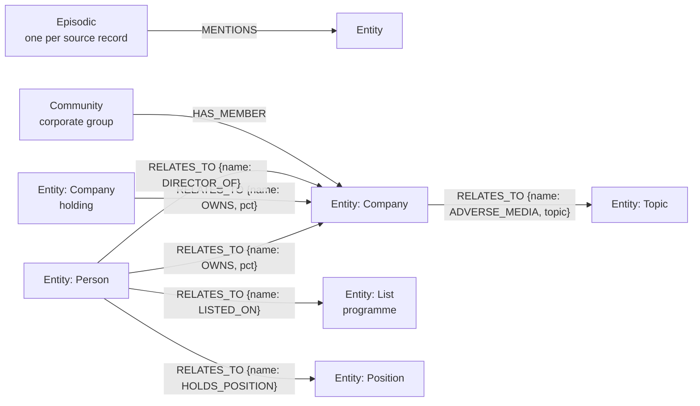

# The data model

The graph is the product; this is its contract. It is defined once in `src/trg/graph/schema.py` and every write goes
through `check_fact`.

## Decisions

| Decision | Why |
|---|---|
| Graphiti's shape: `Entity`, `Episodic`, `Community`, facts as `RELATES_TO` with a `name` | Graphiti tooling and its MCP server can read the graph; one relationship type keeps temporal filters identical for every fact |
| Bi-temporal facts: `valid_at`/`invalid_at` and `created_at`/`expired_at` | "As of" questions need when a fact was true; audits need when we believed it. A filing that removes a shareholder sets `invalid_at`, it does not delete |
| Days as integers since 1970-01-01 | The same comparison on Neo4j and Kùzu, and in list predicates where only literals are portable |
| Lists, positions and topics are entities | A sanctions listing is a fact with its own validity, between a person and a programme |
| Every fact lists its episodes, source and confidence | An analyst can open the filing, list entry, article or page behind any answer |
| Registry shares as given; UK bands stored at their lower bound | A band of 25-50% proves at least 25%, which is what the beneficial-ownership threshold needs |
| Companies whose shareholders no registry publishes are marked | Answers through them abstain instead of reporting an incomplete chain as complete |
